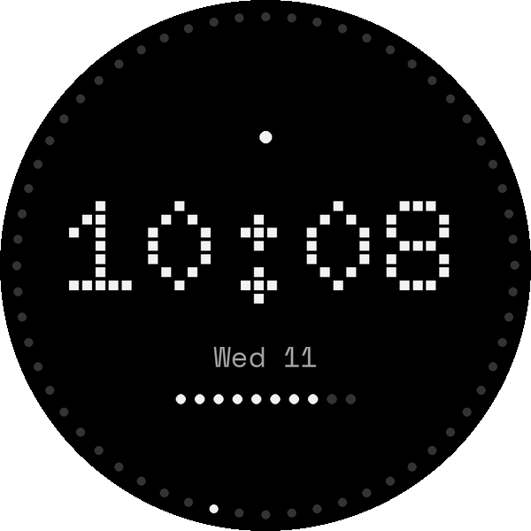
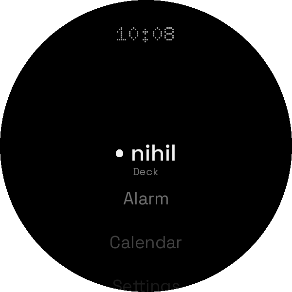
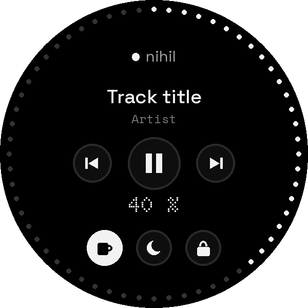

<p align="center">
  <picture>
    <source media="(prefers-color-scheme: dark)" srcset="docs/brand/nihil-logo-dark.svg">
    
  </picture>
</p>

<p align="center"><i>ex nihilo</i></p>

<p align="center">A monochrome, dot-matrix launcher for Wear OS</p>

<p align="center">
  <a href="https://nihilshell.com/wear/">Website</a> &nbsp;&nbsp;&nbsp;
  <a href="#try-it">Try it</a> &nbsp;&nbsp;&nbsp;
  <a href="https://github.com/poligle/Nihil-Launcher">Launcher for Android</a> &nbsp;&nbsp;&nbsp;
  <a href="https://github.com/poligle/Nihil-Shell">Desktop for NixOS</a>
</p>

<p align="center">
  
  &nbsp;
  
  &nbsp;
  
</p>

NIHIL for Wear OS is the watch's side of [NIHIL](https://github.com/poligle/Nihil-Shell): the
desktop's language on the wrist (black, greys for hierarchy, dots for display, red only to
interrupt, light along the edge) and the watch as a deck for the computer, as
[NIHIL for Android](https://github.com/poligle/Nihil-Launcher) is.

It is Kotlin on the Android framework alone, like the phone: no AndroidX, no Compose, no
libraries beyond the Kotlin standard library. Its watch face is Watch Face Format, with no
code at all. Wear OS 4 or newer, the oldest that installs such a face.

---

## What it is

- **The face.** The time in dots; sixty LEDs round the edge, every one there and the unlit
  faintly, the seconds' one lit as the desktop's light runs round its frame; the battery as ten
  LEDs, red at 15 % or less; a LED over the time while something is unread. A tap on the time
  opens NIHIL. In ambient, the time and the day alone, dimmed.
- **Home.** A list: the computer's deck first, then the watch's apps by name, then the network
  test. The bezel or the crown turns it, with a tick as each one passes; what stands in the
  middle is lit in ink and the rest stays grey, as the desktop's apps do.
- **The deck.** The computer's music, with its keys; its volume on the bezel or the crown, a
  step a tick, shown by the LEDs round the edge; its caffeine, night light and lock. The state
  comes every few seconds while it shows, as on the phone.
- **The light on the edge.** As on the desktop and the phone: once round the edge for each
  notification; twice and in red for a call, an alarm or a battery running low (15, 10 and
  5 %); two lights climbing from the bottom when the charger goes in. Over any screen, the face
  too, with notification access and NIHIL's accessibility service (`tools/watch halo`).
- **The network test.** How the watch reaches the computer: over the phone's Bluetooth and over
  Wi-Fi, each with a new connection and again on the same one, and how long mDNS takes to find
  it. Its report also comes out over adb.

Wear OS keeps its own launcher: NIHIL opens from its face, from its icon, or from a button where
the watch lets you choose one.

---

## Install

On the computer, NIHIL with the deck on (Preferences, Devices). On the watch, developer
options: Settings, About watch, tap the build number until they appear; then, in Developer
options, **ADB debugging** and **Wireless debugging**, on the computer's Wi-Fi, and **Pair new
device**. On the computer, Preferences, Devices, **Install on a watch**, or:

```sh
nihil watch            # pairs, installs the latest release and its face, invites the watch
nihil watch update     # a newer release on a watch already paired
nihil watch forget     # the watch and the computer forget each other
```

It finds the watch on the network, so only the code the watch shows is typed; installs the
newest release with its face, checked against the release's `SHA256SUMS`; hands the watch the
deck's invitation and turns on the light on the edge. Then hold the watch's face and choose
NIHIL's. Releases: `RELEASING.md`.

## Try it

To try this checkout instead: on the computer, NIHIL with the deck on (`nihil.deck.enable`, or Preferences, Devices), and
this repository. On the watch, developer options: Settings, About watch, tap the build
number until they appear; then, in Developer options, **ADB debugging** and **Wireless
debugging**, on the computer's Wi-Fi.

```sh
nix develop
tools/watch pair 192.168.1.31:37123 482915    # Wireless debugging, Pair new device
tools/watch connect 192.168.1.31:41209         # the address on Wireless debugging's screen
tools/watch install                            # NIHIL and its watch face, debug builds
tools/watch invite                             # the watch pairs with this computer
tools/watch probe                              # the network test, and what it measured
tools/watch halo                               # the light on the edge, over any screen
```

Then hold the watch's face and choose NIHIL's. `tools/watch probe --json` prints the whole
report; `tools/watch forget` makes the watch and the computer forget each other. With the
phone on adb too, `tools/watch` finds the watch by itself; `NIHIL_WATCH=SERIAL` picks one.

---

## How the watch reaches the computer

A watch has two ways: the phone's Bluetooth, which Wear OS uses on its own, and Wi-Fi, which it
brings up when an app asks for it. The deck tries the default network first and asks for Wi-Fi
only when the computer isn't there; it keeps one connection open while it shows, as the
computer keeps them, and lets the connection and the Wi-Fi go when it closes.

## How the computer reaches the watch

Only through adb. The watch has no camera for the deck's QR, so `tools/watch invite` asks
`nihil-deck pair --json` for what the QR holds (the computer's addresses, the one-time code and
the pin of its certificate) and hands it to the watch with `content call`. The provider that
takes it ([`deck/ShellProvider.kt`](app/src/main/java/com/nihilshell/wear/deck/ShellProvider.kt))
answers adb's shell and nothing else: a computer handed over by any app on the watch could be
anyone's. Wireless debugging's own pairing is what makes the shell the computer.

From there the watch pairs as the phone does
([`docs/deck.md`](https://github.com/poligle/Nihil-Shell/blob/nihil/docs/deck.md)): TLS that
trusts only the certificate of the pin, then the code, for a token of its own, kept encrypted
with a key that never leaves the Android Keystore. To the computer it is one more device,
listed in Preferences, Devices, and forgotten there as a phone is.

---

## The network test

<table>
<tr><td><b>Default network</b></td><td>Where Wear OS sends an app's traffic when the app doesn't say: with the phone near, its Bluetooth.</td></tr>
<tr><td><b>Wi-Fi</b></td><td>Asked for, as Wear OS wants it for what Bluetooth can't carry. <i>Up in</i> is how long it took to come up.</td></tr>
<tr><td><b>mDNS</b></td><td>How long the computer's <code>_nihil-deck._tcp</code> takes to be found, and at what address.</td></tr>
<tr><td><b>Bezel or crown</b></td><td>The turns that reached the app: a crown, a rotating bezel and a touch bezel all come as the same scroll.</td></tr>
</table>

Each way gets three rounds, the middle one shown. A round opens a new connection and asks for
`/v1/hello` twice on it: **first** is TCP, TLS and the first answer, what a first tap costs;
**then** is the second answer, on a connection already open. On top, one request with the
token, `/v1/state`, with the computer's own work in it.

---

## Design language

The same three rules as the desktop and the phone:

1. **Hierarchy is made with greys.** Red only interrupts, and what went wrong is said in ink
   with a red LED before it.
2. **Dots are for display.** The time and the numbers are in Doto; text is Space Grotesk and
   metadata Space Mono.
3. **The frame is hardware.** On a round screen the frame is its edge, and the LEDs follow the
   screen's own shape.

The tokens are the desktop's ([`theme/nihil.nix`](https://github.com/poligle/Nihil-Shell/blob/nihil/theme/nihil.nix)),
mirrored in [`ui/Nihil.kt`](app/src/main/java/com/nihilshell/wear/ui/Nihil.kt). Text is in
English or Spanish, the watch's language.

---

## Build

```sh
nix develop
./gradlew test assembleDebug
```

Two modules: `app`, NIHIL itself, and `watchface`, its face, drawn by
[`tools/watchface.py`](tools/watchface.py) (change that, not the XML it writes).
[`tools/screens.py`](tools/screens.py) renders the face, the home and the deck for this README
and the website. The version, of both, is in `gradle.properties`. The tests are the pure Kotlin
core ([`core/`](app/src/main/java/com/nihilshell/wear/core)): the invitation, HTTP as the deck
speaks it, the report and the turns of the bezel. They run on the JVM.

---

NIHIL is a personal project and is not affiliated with Nothing Technology. Doto,
Space Grotesk and Space Mono are under the [SIL Open Font License 1.1](app/src/main/assets/fonts/OFL.txt).
The icons for caffeine, night light and lock are from [Material Design Icons](https://pictogrammers.com/library/mdi/),
under the [Pictogrammers Free License](https://github.com/Templarian/MaterialDesign/blob/master/LICENSE).
The code is MIT licensed.
