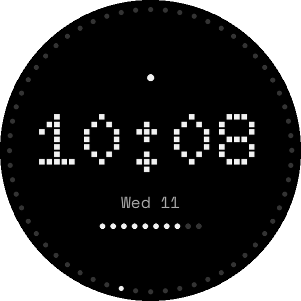
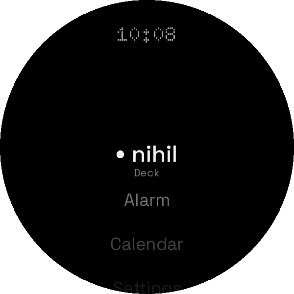
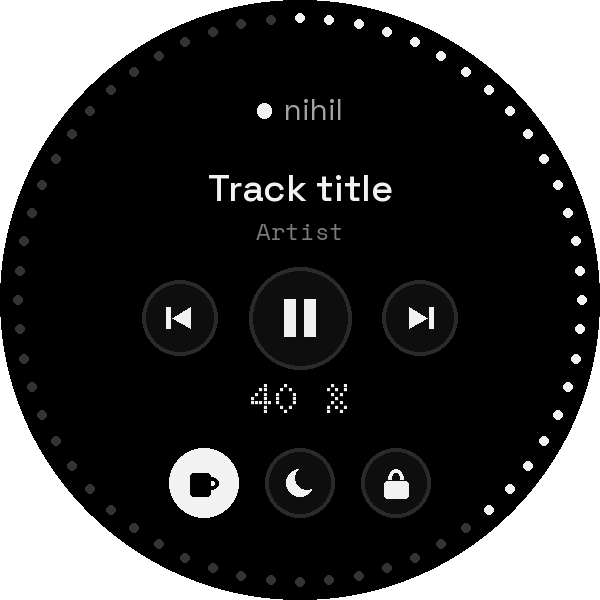

<p align="center">
  <picture>
    <source media="(prefers-color-scheme: dark)" srcset="docs/brand/nihil-logo-dark.svg">
    
  </picture>
</p>

<p align="center"><i>ex nihilo</i></p>

<p align="center">A monochrome, dot-matrix launcher for Wear OS</p>

<p align="center">
  <a href="https://nihilshell.com/wear/">Website</a> &nbsp;&nbsp;&nbsp;
  <a href="#install">Install</a> &nbsp;&nbsp;&nbsp;
  <a href="https://github.com/poligle/Nihil-Launcher">Launcher for Android</a> &nbsp;&nbsp;&nbsp;
  <a href="https://github.com/poligle/Nihil-Shell">Desktop for NixOS</a>
</p>

<p align="center">
  
  &nbsp;
  
  &nbsp;
  
</p>

NIHIL for Wear OS is the watch's side of [NIHIL](https://github.com/poligle/Nihil-Shell): the
desktop's language on the wrist (black, greys for hierarchy, dots for display, red only to
interrupt, light along the edge) and the watch as a deck for the computer, as
[NIHIL for Android](https://github.com/poligle/Nihil-Launcher) is.

It is Kotlin on the Android framework alone, like the phone: no AndroidX, no Compose, no
libraries beyond the Kotlin standard library. Its watch face is Watch Face Format, with no
code at all. Wear OS 4 or newer, the oldest that installs such a face.

## What's in it

- **The face**, in Watch Face Format: the time in dots, sixty LEDs round the edge and the
  battery as ten.
- **A list**, grey until one is chosen, turned by the bezel or the crown.
- **The deck**: the computer's music, its volume on the bezel or the crown, its caffeine,
  night light and lock.
- **The light on the edge**, as on the desktop and the phone.
- **A network test** of how the watch reaches the computer.

## Install

On the watch, developer options: Settings, About watch, tap the build number until they
appear; then, in Developer options, **ADB debugging** and **Wireless debugging**, on the
computer's Wi-Fi, and **Pair new device**. On the computer, with NIHIL's deck on,
Preferences, Devices, **Install on a watch**, or:

```sh
nihil watch
```

Then hold the watch's face and choose NIHIL's. Updating it, forgetting it and trying a
checkout are in [Install](docs/install.md).

## Learn more

- [Everything in it](docs/features.md)
- [Install, try it and build](docs/install.md)
- [The watch and the computer](docs/network.md), and the network test
- [Design](docs/design.md)

---

NIHIL is a personal project and is not affiliated with Nothing Technology. Doto,
Space Grotesk and Space Mono are under the [SIL Open Font License 1.1](app/src/main/assets/fonts/OFL.txt).
The icons for caffeine, night light and lock are from [Material Design Icons](https://pictogrammers.com/library/mdi/),
under the [Pictogrammers Free License](https://github.com/Templarian/MaterialDesign/blob/master/LICENSE).
The code is MIT licensed.
